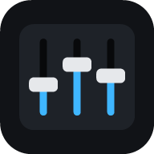
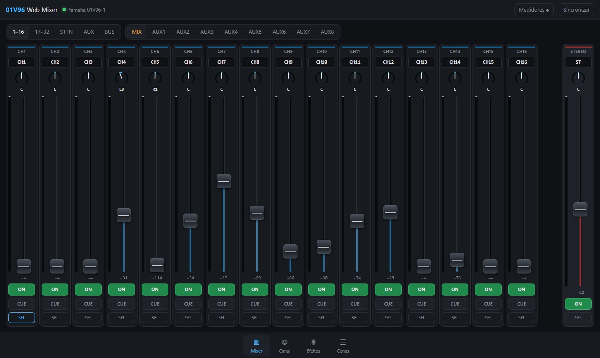
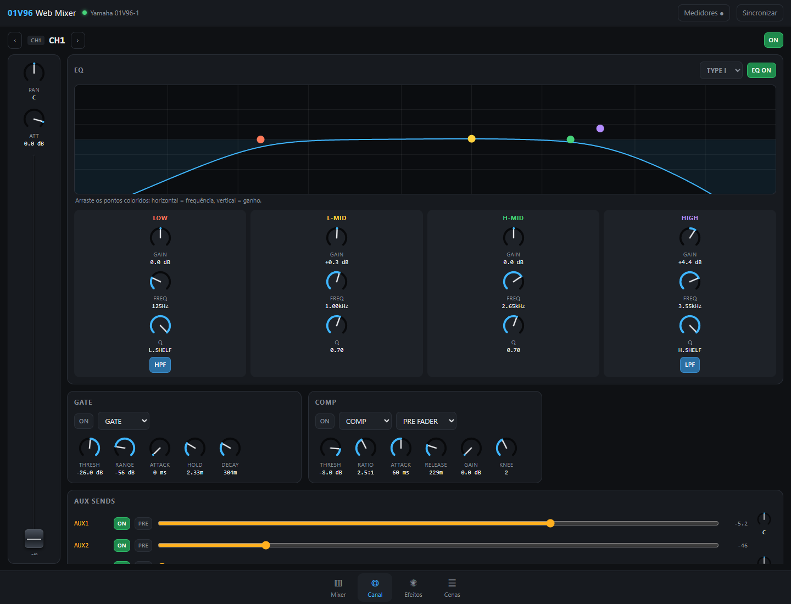
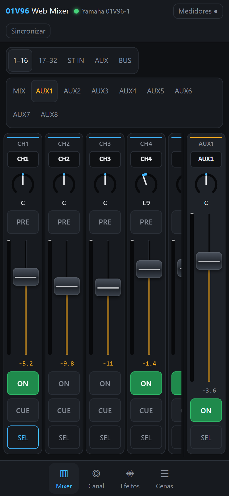
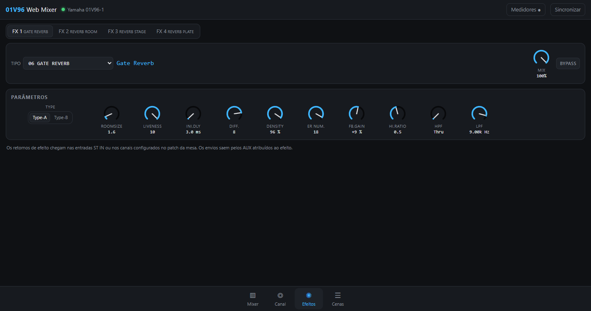

<div align="center">



# 01V96 Studio Web

**Controle sua Yamaha 01V96 pelo navegador, no PC, tablet ou celular.**
Sem Studio Manager e sem drivers estranhos: um servidor Node.js local fala com a mesa via USB-MIDI e entrega uma interface web moderna, responsiva e touch.




</div>

---

## ✨ O que já funciona

| | |
|---|---|
| 🎚️ **Mixer** | 32 canais, 8 ST IN, AUX 1–8, BUS 1–8 e STEREO, com fader, ON, pan, CUE, nomes e medidores ao vivo |
| 🔁 **Sends on fader** | Transforma os faders em envios para qualquer AUX (monitor, fones, retorno de palco) |
| 🎛️ **Canal (SEL)** | EQ de 4 bandas com gráfico arrastável, HPF/LPF, gate, compressor, 8 envios AUX, roteamento, delay, phase, insert, pair e grupos |
| ✺ **Efeitos 1–4** | Os **61 tipos** de efeito da mesa (REV-X, delays, chorus, amp sim, comp 276/260, EQ601…) com todos os parâmetros, nas unidades da mesa |
| ☰ **Cenas** | Títulos, recall e store |
| 👆 **Touch** | Faders e knobs para dedos, toque duplo volta ao padrão, EQ arrastável, vários dedos ao mesmo tempo |
| 📲 **PWA** | Instalável, abre mesmo com o servidor desligado e avisa claramente quando está offline |
| 🔄 **Tempo real** | O que você mexe na mesa aparece no navegador, e vice-versa, em todos os aparelhos conectados |
| 🛡️ **Resiliente** | O servidor reinicia sozinho se o driver MIDI falhar e reconecta quando o USB volta |

<table>
<tr>
<td width="62%"></td>
<td width="38%"></td>
</tr>
<tr>
<td colspan="2"></td>
</tr>
</table>

## 🚀 Começando

**Pré-requisitos**

- Yamaha 01V96 / 01V96i ligada via USB
- [Driver Yamaha USB-MIDI](https://usa.yamaha.com/support/updates/) instalado: a mesa deve aparecer como `Yamaha 01V96-1`
- [Node.js](https://nodejs.org) 20 ou mais novo

```bash
git clone https://github.com/GregoryGitHub/01v96-studio-web.git
cd 01v96-studio-web/app
npm install
npm start
```

Abra **http://localhost:8096**. O terminal também mostra o endereço da rede local, para abrir no tablet ou no celular.

### Atalho na área de trabalho (Windows)

```powershell
powershell -ExecutionPolicy Bypass -File launcher\install-shortcut.ps1
```

O atalho **01V96 Mixer** inicia o servidor oculto (se ainda não estiver rodando) e abre o mixer numa janela própria. Para parar o servidor, rode `launcher\stop.ps1`.

### Configuração

| Variável | Padrão | Para quê |
|---|---|---|
| `PORT` | `8096` | Porta HTTP/WebSocket |
| `MIDI_PORT` | `01V96(i)?-1` | Regex do nome da porta MIDI |
| `NO_SUPERVISOR` | — | `1` roda sem o auto-restart (útil para depurar) |

> ⚠️ Feche o **Studio Manager** e o **AirFader** enquanto usa: eles disputam a mesma porta USB-MIDI e deixam tudo lento.

## 🧠 Como funciona

```
 navegador(es) ──WebSocket──▶ app/server.js ──USB-MIDI (SysEx)──▶ Yamaha 01V96
      ▲                          │  supervisor + cache de estado
      └──── mudanças da mesa ────┘
```

- **`app/lib/protocol.js`**: codifica e decodifica o SysEx da Yamaha (parameter change, request, bulk, meters).
- **`app/lib/model.js`**: quais elementos e parâmetros existem e o plano de sincronização.
- **`app/lib/console.js`**: porta MIDI, fila de pedidos com controle de fluxo, cache de estado, medidores, cenas.
- **`app/public/`**: interface em JavaScript puro (ES modules, sem build): `controls.js` (fader/knob touch), `views/*`.
- **`app/data/`**: tabelas de interoperabilidade obtidas por engenharia reversa (elementos, catálogo de efeitos, tabelas de exibição).

O protocolo inteiro, com endereços, formatos e descobertas, está documentado em **[docs/protocol.md](docs/protocol.md)**.

## 🤝 Contribua: leve isso para outras mesas!

A família digital da Yamaha daquela época compartilha o mesmo protocolo: **02R96, DM1000, DM2000, 01V96i, LS9, M7CL, PM5D**. O Studio Manager de cada uma usa a mesma estrutura de tabelas que já sabemos ler. Isso torna o projeto um ótimo ponto de partida para suportar várias mesas.

Formas de ajudar:

- 🧪 **Tem uma mesa Yamaha?** Rode o app, teste e abra uma issue com o que funcionou e o que não funcionou.
- 🎛️ **Nova mesa:** siga o guia em **[CONTRIBUTING.md](CONTRIBUTING.md#adicionando-uma-nova-mesa)**. Ele explica como extrair as tabelas do Studio Manager com os scripts de `re/`.
- 🎨 **Interface:** GEQ, matrix de patch, biblioteca de efeitos, layouts personalizados, temas.
- 🌍 **Traduções:** a interface está em português; ajude a deixá-la multilíngue.
- 📖 **Documentação:** parâmetros ainda sem rótulo, fotos, tutoriais.

Leia o **[CONTRIBUTING.md](CONTRIBUTING.md)** para o fluxo de trabalho, os padrões de código e a regra de ouro: *nunca teste escrita em uma mesa que está tocando ao vivo*.

## 🗺️ Roadmap

- [x] Mixer, canal, efeitos, cenas, medidores
- [x] PWA + modo offline + atalho Windows
- [x] Touch completo (tablet/celular)
- [ ] Camada de "drivers" para várias mesas (`consoles/01v96`, `consoles/dm1000`…)
- [ ] GEQ e patch de entradas e saídas
- [ ] Rótulos para os ~120 parâmetros de efeito restantes (HOLD/DECAY, NOTE, REV-X)
- [ ] Biblioteca de efeitos e cenas (salvar e carregar no navegador)
- [ ] Layouts de usuário (escolher quais canais aparecem para cada músico)
- [ ] Instalador para macOS e Linux
- [ ] Testes automatizados com uma mesa simulada

## ⚖️ Aviso legal

Projeto independente, sem afiliação com a Yamaha Corporation ou com o AirFader. "Yamaha", "01V96" e "Studio Manager" são marcas de seus donos. O protocolo foi documentado por engenharia reversa **para fins de interoperabilidade**. O repositório não contém nenhum software proprietário. Use por sua conta e risco: teste antes de usar ao vivo.

---

<details>
<summary><b>🇺🇸 English summary</b></summary>

**01V96 Studio Web** is a local web app (Node.js + vanilla JS PWA) that controls a Yamaha 01V96 over USB-MIDI from any browser: phone, tablet or desktop. It covers faders, mutes, pan, sends on fader, full channel strip (4-band EQ with draggable graph, gate, comp, routing, delay), all 61 internal effect types with every parameter, scenes and live meters. Touch-first controls, installable PWA with an offline screen, and a self-restarting server.

The SysEx protocol was reverse engineered from Studio Manager and AirFader (see [docs/protocol.md](docs/protocol.md)). Other Yamaha digital desks of the same generation (02R96, DM1000, DM2000, LS9, M7CL…) share the protocol family. **Contributions to support them are very welcome**; start with [CONTRIBUTING.md](CONTRIBUTING.md).

```bash
cd app && npm install && npm start   # http://localhost:8096
```
</details>
